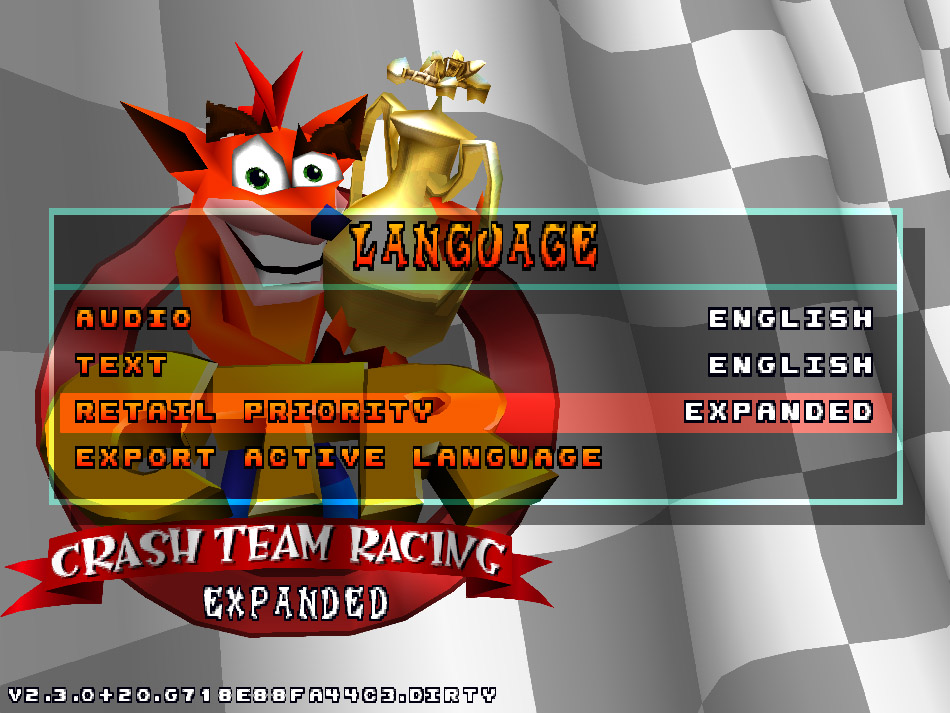
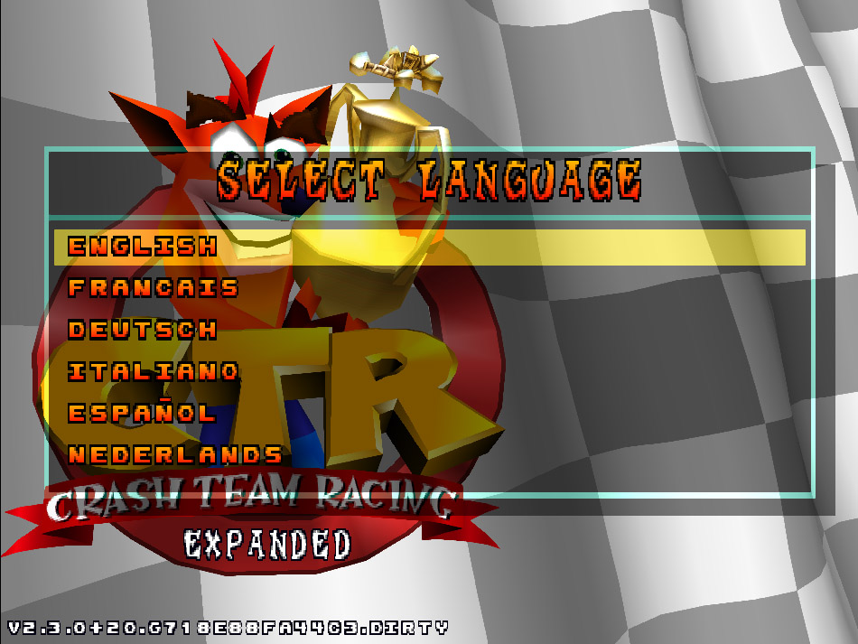

# Language Selection and Translations

CTR Native Expanded lets you choose the text and voice languages independently.
English, French, German, Italian, Spanish and Dutch text catalogs are included;
you can also add your own text translations. The optional European disc supplies
additional voice languages and an alternative source of original-game text.

## Choose a language

1. Open **Options > System > Language**.
2. Select **Text** or **Audio**, choose a language from the list and confirm.
3. Leave Options to save your choices. Changes apply immediately.

Both selections default to English. You can combine, for example, Italian text
with English voices. The text list includes installed catalogs and available disc
languages; the audio list depends on the available voice resources. If a voice
track is missing, the game falls back to English.

| Option                     | Values                                            | Default  | Description                                                                                                                                                                                    |
|----------------------------|---------------------------------------------------|----------|------------------------------------------------------------------------------------------------------------------------------------------------------------------------------------------------|
| **Audio**                  | English                                           | English  | Voice language; non-English choices require available European disc resources. When the PAL EU image is provided, French, German, Italian, Spanish, Dutch become available as audio languages. |
| **Text**                   | Built-in languages and installed custom languages | English  | Language used for game text. Available choices depend on installed catalogs and disc resources.                                                                                                |
| **Retail Priority**        | EXPANDED, ISO EU                                  | EXPANDED | Preferred source for original-game text. ISO EU requires European disc text.                                                                                                                   |
| **Export Active Language** | Action                                            | —        | Creates editable text templates for the selected language without overwriting existing files.                                                                                                  |



### Optional European disc

To use the European disc's supported voices or original-game text, place your
own European disc image at `assets/ctr-e.bin`. The usual NTSC-U base image at
`assets/ctr-u.bin` is still required. 

```text
CTR-Native/
  ctr_native_expanded.exe
  resources/text/       included text catalogs
  assets/
    ctr-u.bin           required base disc
    ctr-e.bin           optional European disc
```

**Retail Priority** selects the preferred source for original-game text:
**EXPANDED** uses the included translation first; **ISO EU** prefers the
European disc. ISO EU is available only when European text is detected. Personal
text overrides take precedence over either choice. The included retail translations were
authored for this fork rather than extracted from retail discs.



## Customize existing text

1. Select the text language you want to customize.
2. Choose **Export Active Language** in the Language menu. The game creates
   `assets/text/<id>/retail.toml` and `expanded.toml`, containing the currently
   resolved text, including any active overrides.
3. Open the files in a UTF-8 text editor. Each entry is commented out with `#`.
   Remove the `#` only from entries you want to change, edit their quoted values,
   and save the files.
4. Reload the language by selecting it again, or restart the game. Check the
   affected screens for readability and layout.

**DONE** indicates a successful export. **FILES EXIST** means at least one
destination already exists: existing files are never overwritten, although a
missing companion file is still created. Back up or move your files elsewhere
before exporting fresh templates. **EXPORT FAILED** indicates an error; check
that the assets directory is writable and has free space.

## Add a text language

Create a folder under `assets/text/` with an ID of 1–31 lowercase ASCII letters,
digits, hyphens or underscores. Add `language.toml` with the language's name as
shown in the menu and at least one catalog file:

```text
assets/text/pt/
  language.toml
  retail.toml       optional original-game text
  expanded.toml     optional Expanded text
```

```toml
# assets/text/pt/language.toml
self_name = "PORTUGUES"
```

Restart the game and select the new language under **Text**. Discovery requires
valid name metadata and an openable `retail.toml` or `expanded.toml`; it does
not validate the catalog contents until loading. 

Catalogs can be partial. To build one, use the exported templates as a key
reference, copy the relevant files into the new language folder and translate
the entries you need. `retail.toml` contains original-game keys; `expanded.toml` contains keys for text added by this fork. Do not
edit the catalogs under `resources/text/`: updates may replace them. Personal
files under `assets/text/` are applied automatically.

To change the displayed name of an existing language, put a `language.toml`
with `self_name` in its `assets/text/<id>/` folder. Restart after changing names,
which are cached while the game runs.

## Translation rules and fallback

- Save valid TOML as UTF-8. Use the exact key names from the templates; unknown
  keys, non-string values and invalid entries are ignored. A malformed TOML file
  cannot be loaded.
- The game font supports printable ASCII, `Ñ`, `¡` and `¿`; other Unicode
  characters such as accented vowels are not accepted. Use supported alternatives
  and check the result in game. Preserve exported `\uE0XX` escapes, which
  represent original game-font bytes. `\r` represents a line break in text.
- Keep original printf-style directives such as `%s` exactly as exported, in
  the same order. For Expanded entries with named placeholders such as
  `{tracks}` and `{skipped_music}`, keep every original placeholder; they may be
  reordered or repeated, but do not add new ones.
- Retail overrides take priority over the selected retail source. If a string is
  unavailable or invalid, the game uses an available source or base English.
  Expanded strings fall back through the selected language's included catalog,
  English personal overrides and the included English catalog. Partial packs can
  therefore show a mixture of languages.
- Exported text can include content from your own disc. Consider its ownership
  and distribution rights before sharing an export; share your own translations
  rather than proprietary disc content.

## Troubleshooting

- **Language missing:** restart after installing it; check the folder ID, valid
  `language.toml`, and that at least one catalog can be opened. For voices,
  check the European disc path and format.
- **Some text remains English:** the catalog may be partial, invalid, or contain
  unsupported characters or mismatched formatting. Check the game's console
  output for `[Language]` messages. Confirm the correct text language and retail
  priority are selected.
- **Changes do not appear:** save the file as UTF-8 under `assets/text/<id>/`,
  uncomment the intended entries and reload the language or restart. Check that
  the keys are in the correct catalog and formatting directives are unchanged.
- **Language name did not change:** check `self_name` and supported font
  characters, then restart to clear the cached name.
